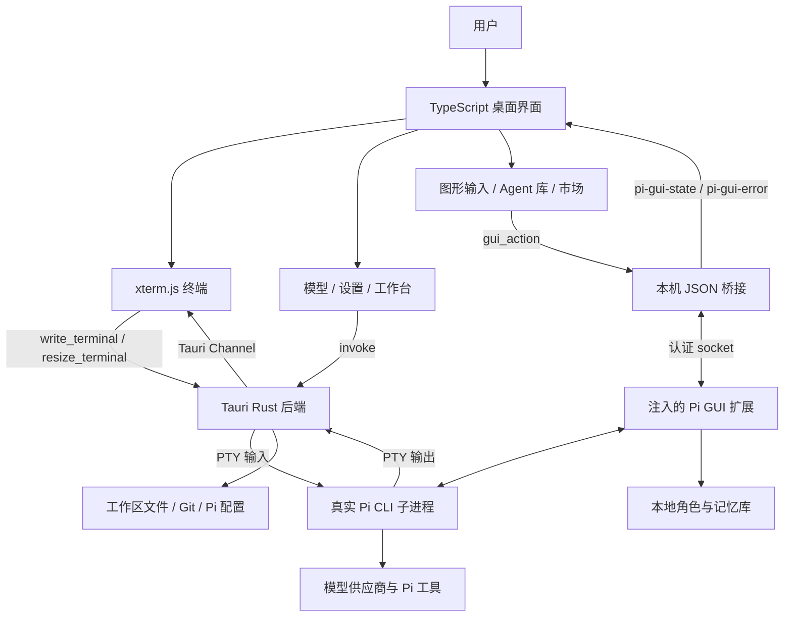

# 工程架构

[返回首页](../README.md) · [使用与配置](USAGE.md) · [开发与验证](DEVELOPMENT.md)

## 1. 设计定位

easy_pi 是承载真实 Pi CLI 的本地桌面工作台。它不重写模型推理与编码 Agent 核心，也不是 HTTP Agent 服务、多租户平台或多 Agent 调度器。

每个窗口管理一个活动 Pi 子进程；常规/壁纸两种布局以及图形/TUI 输入共用同一进程。切换工作区或恢复会话需要处理当前任务、草稿和未保存文件，再重启该进程，并不是同时保持多个后台工作区执行。

## 2. 分层与数据流

图中是模块和数据通道，不是多个联网服务器。普通浏览器预览没有完整 Tauri 原生能力；生产应用由桌面 WebView 与 Rust 后端共同组成。

### 通道 A：真实终端

1. `xterm.onData` 收集 TUI 输入。
2. 前端调用 `write_terminal`，Rust 写入 PTY。
3. Pi 输出由 PTY 读取线程经 Tauri Channel 回传。
4. 前端批量写入终端，渲染与流控逻辑处理尺寸、输出和滚动。

这条路径保留真实 TUI 的选择器、键盘和输出，不要求把终端画面重新解释为聊天记录。

### 通道 B：图形操作与结构化状态

1. 前端通过 `gui_action` 请求结构化操作。
2. Rust 桥接使用换行分隔 JSON 帧与 Pi 扩展通信。
3. 扩展调用 Pi 编辑器/上下文接口，执行允许的提交、命令、状态和库操作。
4. 状态与错误经 `pi-gui-state` / `pi-gui-error` 更新界面。

GUI 状态来自结构化事件，而不是屏幕文本猜测。普通消息、Pi 指令和 shell 输入有不同入口；原生编辑器已有草稿或弹窗时不会无条件覆盖。

## 3. 模块职责

| 文件 / 模块 | 职责 |
| --- | --- |
| `index.html` | 页面结构、面板与基础交互节点 |
| `src/main.ts` | 应用装配、终端生命周期、事件绑定与设置入口 |
| `src/bridge.ts` | Tauri invoke 包装、桌面/浏览器能力判断 |
| `src/terminal-flow.ts` / `terminal-renderer.ts` | 终端输出处理、流控与渲染设置 |
| `src/composer-state.ts` | 图形输入状态与草稿相关逻辑 |
| `src/workbench.ts` | 文件、会话、Git、附件和工作区切换 UI |
| `src/model-dialog.ts` / `model-list.ts` / `model-bulk.ts` | 模型编辑、列表和批量操作 UI |
| `src/agent-market.ts` / `library-settings.ts` | 文本 Agent 市场、本地库设置与操作 |
| `src/keybinding-settings.ts` / `keybindings-data.ts` | 快捷键定义与配置界面 |
| `src/wallpaper-*.ts` / `sound-*.ts` / `ui-sounds.ts` | 外观、壁纸、音效与本地偏好 |
| `src/ui-strings.ts` | 中英文界面文案 |
| `src-tauri/src/lib.rs` | 原生命令注册、PTY 生命周期、配置、插件导入和日志 |
| `src-tauri/src/runtime.rs` | Pi 运行时查找、Windows bundle 检查和命令规格 |
| `src-tauri/src/gui_bridge.rs` | socket、握手、帧处理、请求与关闭 |
| `src-tauri/src/gui-extension.ts` | 注入 Pi 的扩展、状态同步和 GUI 动作 |
| `src-tauri/src/gui-library.mjs` | 本地记忆/Agent 持久化、授权及文本导入 |
| `src-tauri/src/gui-market.mjs` | 8 个内置纯文本角色的目录与来源元数据 |
| `src-tauri/src/model_management.rs` | 模型目录合并、编辑、批量移除/恢复和写入事务 |
| `src-tauri/src/workbench.rs` | 文件/会话作用域、文本保存、Git 状态和差异命令 |
| `scripts/test.mjs` / `verify.mjs` | 测试发现与分层验证汇总 |
| `scripts/prepare-windows-runtime.mjs` | 固定 Windows 运行时解包与校验 |
| `scripts/package-source.mjs` | 源码包交付；不是桌面编译器 |

## 4. Pi 进程与运行时生命周期

### 查找顺序

`PI_EXECUTABLE` → Windows 应用资源中的完整固定运行时 → 外部 Pi 搜索。

- 显式路径必须是现存可执行绝对路径；错误值直接报错。
- Windows bundle 缺失时可以搜索外部 Pi；已存在但不完整时报告修复错误。
- bundled 模式直接调用绝对 `node.exe` 加 Pi JavaScript 入口，不依赖批处理拼接。
- 外部模式保留平台 shim 兼容处理；Unix 搜索常用本地 bin 与 PATH，不读取任意交互 shell 初始化文件。

### 启动与关闭

后端准备工作目录、终端环境和本地桥接，把 GUI 扩展作为当前 Pi 的 `--extension` 注入，而不是全局安装。PTY 读写和窗口状态分别管理；关闭时关闭桥接、终止并等待子进程，清理临时扩展目录。

终端环境包含 `TERM=xterm-256color`、`COLORTERM=truecolor` 及 UTF-8 回退处理。环境传递逻辑不是隔离沙箱；不能因为存在变量白名单式处理就承诺子进程只可看到这些变量。

## 5. 桥接协议边界

| 项目 | 实现边界 |
| --- | --- |
| Unix 传输 | 私有临时目录与 Unix socket，目录权限设置为 0700 |
| Windows 传输 | `127.0.0.1` 随机端口 TCP |
| 认证 | 每次启动使用 24 随机字节 token 握手 |
| 内部参数 | 应用注入 `PI_GUI_SOCKET` 与 `PI_GUI_TOKEN` |
| 消息 | 换行分隔 JSON，单帧限制 1 MiB |
| 状态 | 结构化状态/错误事件回传前端 |

这些措施用于约束本地桥接连接和消息处理，不为同账户恶意进程提供绝对防护，也不限制 Pi 工具对文件或命令的本机权限。不要暴露内部 token 或把桥接端口绑定到公网。

## 6. 配置、状态与写入一致性

### Pi 与 GUI 文件

主要路径是 `HOME/.pi/agent/`；GUI 直接读写模型、自定义配置、角色和快捷键。自定义 Pi 数据目录变量没有在 GUI 各路径完整适配，不能承诺仅设置 `PI_CODING_AGENT_DIR` 就能实现全应用目录迁移。完整位置表见 [使用指南](USAGE.md)。

### 模型事务

模型列表合并 `models-store.json` 与 `models.json`，并读取认证/默认设置及 `gui-models.json` 移除状态。模型可见性不是在线连通性检查。

写入路径包含 JSON 对象验证、临时文件替换、Unix 私有权限、快照过期检测和多文件失败回滚。编辑信息只向界面返回 `hasKey`，新填写的 Key 才覆盖共享供应商配置。这不等于密钥已加密，也不替代用户备份。

### 前端状态

外观、语言、工作区、草稿和会话置顶/归档展示状态使用 WebView localStorage；自定义壁纸在 IndexedDB；图片附件缓存使用 Tauri 应用缓存目录。会话归档只是 GUI 展示标签，不移动 Pi JSONL 文件。

## 7. 本地库与纯文本市场

本地库中的 Agent 是文本角色；全局一次只激活一个，任务开始时附加角色和受限长度的近期记忆。没有基于它自动启动子进程或并行 Agent 的机制。

模型侧库工具分别暴露记忆的 list/read/save、角色库的 list/read/download，不授予模型修改授权、激活角色或删除库记录的入口。记忆和下载授权当前默认开启，用户可关闭；下载落盘前再次检查授权。

市场是内置角色目录加公开 GitHub 单文件预览。限制来源、扩展名、大小、超时、重定向和文本编码，使用预览同意、内容哈希和有效期；**预览、导入、启用是三步不同操作**。这些是库/提示层边界，不是完整 prompt-injection 防护或全局工具权限系统。

另一个插件导入入口执行 `pi install <source>`，与纯文本市场不是同一信任边界。它可能拉取并执行第三方包/扩展，必须单独审查来源。

## 8. 文件与 Git 工作台边界

- 文件 API 拒绝绝对/父级越界以及工作区外 symlink；现存 UTF-8 文本读取限制 512 KiB。
- 保存使用 revision 检查外部变化，保留原权限；不是通用文件管理器或数据库事务层。
- 搜索为路径包含匹配，上限 100 个结果、20000 个候选，并非全文索引。
- 会话源自 Pi JSONL，限制扫描深度、近期条数和单文件读取量。
- Git 依赖系统 `git`，支持状态、diff、分支三点比较、逐文件暂存/取消暂存；不负责提交、推送或合并。
- Git 路径/参数有单独验证与输出限制，但不能据此保证不可信仓库的所有外部工具调用安全。

GUI 文件范围限制不传播为 Pi 的一般工具限制。首次打开陌生项目、修改文件或安装扩展之前，用户仍需要自行判断信任与权限。

## 9. 已知工程限制

1. 普通浏览器只可预览 UI，不提供完整本地 Pi 工作流。
2. 外部 Pi 的扩展 API 变化可能影响 GUI，不能承诺任意版本兼容。
3. Windows 当前源包需要未跟踪的固定离线档案；现有 CI 没有取得该档案的步骤。
4. 部分 Windows 附件/路径 UI 仍有 POSIX 路径假设；其他平台的原生选择器没有完整实现。
5. 基础 Tauri 配置 `csp: null`，没有启用自定义 CSP 防线；不能宣称 WebView 已全面加固。
6. API Key 可能在本地 JSON 中保存，没有 OS Keychain 或全目录加密保证。
7. 没有自动更新配置、云端同步、远程多租户权限系统或模型权重管理。
8. 安装包构建、签名、公证和平台验证必须单独执行并记录，不能从源码存在推断成功。

## 10. 后续演进建议（不是已实现功能）

- 为 Windows 源码/运行时输入建立可复现、可核验的分发流程，再恢复真实原生发布验证。
- 补齐 Windows 盘符/UNC 路径、跨平台附件与原生选择器测试。
- 集中 Pi 数据目录解析，明确自定义目录迁移策略。
- 研究凭据安全存储与 CSP 加固，并保持原有配置迁移兼容。
- 按平台记录真实 Pi 联调、签名/公证、安装与卸载结果。

本节仅为基于当前结构的改进方向，不代表已合并路线图或交付承诺。
